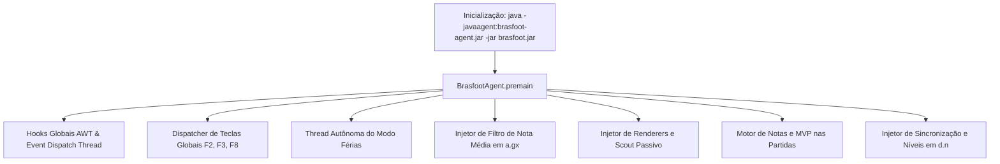

# Documentação Completa da Suíte de Mods — Brasfoot 22-23

Guia técnico e funcional detalhado de todos os módulos desenvolvidos para o **Brasfoot 2022-2023** via arquitetura de **Java Agent** (`brasfoot-agent.jar`).

## **Índice**

---

## 1. Arquitetura Geral do Java Agent

A integração com o motor original do Brasfoot ocorre em tempo de execução via **Java Instrumentation** (`-javaagent:brasfoot-agent.jar`). Isso dispensa qualquer modificação destrutiva no executável original (`bf22-23.jar` / `bf22-23.exe`), preservando 100% da estabilidade e compatibilidade dos saves.



### Classes Centrais de Suporte

- **`BrasfootAgent.java`**: Ponto de entrada (`premain`), gerenciador do ciclo de vida, captura de atalhos globais, injeção de telas (`a.gx`, `a.bn`, `d.n`) e busca recursiva de componentes Swing via Reflection.
- **`InGameModLauncher.java`**: Launcher in-game com patch de velocidade de simulação (`1ms`) e atalhos rápidos.

---

## 2. Módulo 1: Modo Férias Automatizado (Holiday Mode)

O **Modo Férias** permite ao treinador definir um período de afastamento do clube. O assistente técnico assume a gestão diária, escala titulares, simula jogos, avança rodadas e descarta modais de forma 100% autônoma.

### 2.1 Estrutura de Classes

- **`BrasfootVacationController.java`**: Controlador central da máquina de estados, sincronização de calendário e navegação de telas.
- **`BrasfootVacationDialog.java`**: Janela modal de configuração das férias (escolha de datas, critérios de parada e delegações).
- **`BrasfootVacationOverlay.java`**: Banner moderno em tempo real no topo da tela exibindo progresso, datas e placares da simulação.
- **`BrasfootVacationReportDialog.java`**: Relatório executivo consolidado exibido ao retornar das férias (*"Bem-vindo de volta, Professor!"*).

### 2.2 Funcionalidades Principais

1. **Sincronização com o Calendário Oficial (`c.a.SR.R()`)**:
    - As férias operam sobre as datas oficiais agendadas no save (`rodada.a()`), garantindo que jogos de meio de semana (Libertadores, Copa do Brasil) e finais de semana sejam rigorosamente disputados e contabilizados.
2. **Opção Inteligente *"Até o Fim do Estadual"***:
    - Detecta automaticamente competições estaduais (`f.o` com `b() == 3` e estado igual a `clube.getEstado()`).
    - Projeta a data exata da final considerando as fases de mata-mata da federação.
    - **Trava Preemptiva**: Interrompe as férias imediatamente antes do início da primeira partida de campeonato nacional (Série A/B/C/D), impedindo que jogos do Brasileirão comecem sem o treinador.
3. **Mecanismo Anti-Travamento no Intervalo (`verJanelaSubs = 0`)**:
    - O motor nativo do Brasfoot pausa no 45º minuto (`a.cD`). O agente define nativamente `c.a.SR.setVerJanelaSubs(0)` e intercepta janelas modais via `WINDOW_OPENED`, permitindo que a partida simule do minuto 1 ao 90+ de forma contínua.
4. **Navegação e Resolução Automática de Telas**:
    - `a.eg` (Elenco): Clica em *"Escalar Time"*.
    - `a.bz` (Pré-Jogo): Clica em *"Jogar >>"* (`oh()`).
    - `a.dV` (Partida): Monitora o andamento e fecha telas de intervalo.
    - `a.gh_0` / `a.gb` / `a.C`: Resolve e dispensa pênaltis e animações instantaneamente.
    - `a.hk` (Tabela pós-jogo): Clica em *"Continuar >>"* (`zK` / `nx()`).
    - `a.dz` (Leilão): Pula ou avança leilões (`Gb`, `Ge`).
    - `a.bl` / `a.dm`: Descarta avisos de demissão da rodada.
    - `a.gO` / `a.jm`: Recusa convites de seleções ou propostas de compra conforme configurado.
5. **Prevenção Dupla de Duplicidades**:
    - Identidade de objeto JVM via `Collections.newSetFromMap(new IdentityHashMap<>())` sobre cada `matchObj` (`best.I`).
    - Chave composta unificada: `clubeCasa_x_clubeFora_dataRodada`.

---

## 3. Módulo 2: Sistema de Notas em Tempo Real & MVP da Partida

Adiciona ao motor de jogo a avaliação individual de desempenho dos atletas com notas de **0 a 10** inspiradas em SofaScore e WhoScored, além da eleição do Craque do Jogo.

### 3.1 Estrutura de Classes

- **`LiveRatingCalculator.java`**: Algoritmo matemático de cálculo dinâmico das notas.
- **`LiveRatingWindow.java`**: Painel visual exibindo a escalação e notas dos 22 jogadores em campo durante a partida.
- **`MatchMvpController.java`**: Eleição e destaque visual do Craque da Partida (MVP).

### 3.2 Escala de Cores e Notas

| Faixa de Nota | Classificação | Cor Visual |
| --- | --- | --- |
| **8.0 a 10.0** | Excelente | Verde Escuro (`#27AE60`) |
| **7.0 a 7.9** | Bom | Verde Claro (`#2ECC71`) |
| **6.0 a 6.9** | Médio | Amarelo Ouro (`#F39C12`) |
| **5.0 a 5.9** | Fraco | Laranja (`#E67E22`) |
| **< 5.0** | Ruim | Vermelho (`#E74C3C`) |

### 3.3 Critérios do Algoritmo (`LiveRatingCalculator`)

- **Nota Base**: Varia entre 6.0 e 6.7 conforme o placar parcial e o tempo decorrido.
- **Impacto Ofensivo**:
    - Gol marcado: `+1.0` a `+1.5` (gols decisivos ou da virada pontuam mais).
    - Assistência: `+0.6` a `+0.9`.
- **Impacto Defensivo & Goleiros**:
    - Goleiros e zagueiros mantendo *Clean Sheet* (sem sofrer gols) recebem bônus progressivo até o minuto 90.
    - Gols sofridos reduzem a nota do setor defensivo de forma proporcional.
- **Punições Disciplinares**:
    - Cartão Amarelo: `-0.4`.
    - Cartão Vermelho: `-1.5` a `-2.0`.
- **Craque do Jogo (MVP)**:
    - Eleito automaticamente ao final do confronto (maior nota, gols e assistências).
    - Recebe uma estrela dourada nativa ao lado do nome na tabela pós-jogo (`MatchMvpController`), sem pop-ups intrusivos.

---

## 4. Módulo 3: Motor de Simulação Instantânea de Partidas (F8)

Permite ao jogador acelerar qualquer partida normal do Brasfoot para conclusão em milissegundos.

### 4.1 Mecanismo

- **Atalho Global F8**: Pode ser disparado antes da bola rolar ou a qualquer momento durante o jogo.
- **Patch de Velocidade em Memória**:
    - Modifica diretamente os timers internos de delay do Brasfoot para `1ms`.
    - Desativa o modal de substituição aos 45 minutos (`setVerJanelaSubs(0)`).
    - Desativa o apito e a reprodução de áudios de lances (`setTocarSom(false)`).
- **Tratamento de Pênaltis em Partidas Eliminatórias**:
    - Intercepta os diálogos `a.gh_0` e `a.C`, confirmando todos os batedores e resolvendo as disputas instantaneamente.

---

## 5. Módulo 4: Central de Estatísticas & Análise Avançada de Elencos

Painel auxiliar de BI e gestão de equipes do Brasfoot, acessível via **F2** ou launcher.

### 5.1 Estrutura de Classes

- **`BrasfootStatsWindow.java`**: Interface rica com gráficos, tabelas e visualizador de dados.

### 5.2 Recursos

- **Visão Geral por Clube**:
    - Média de idade do elenco, força geral e número total de atletas.
    - Dados de infraestrutura: nome do estádio, capacidade e divisão.
    - Cores oficiais do clube com preview visual das camisas.
- **Tabela de Atletas**:
    - Força, idade, lado preferencial, características especiais (ex: Cabeceio, Velocidade, Passe) e status de transferência.
- **Rankings Globais**:
    - Maiores estádios do jogo.
    - Elencos mais jovens e elencos mais experientes.
    - Clubes mais ricos e maiores forças táticas.

---

## 6. Módulo 5: Filtro de Nota Média e Coluna na Busca de Jogadores (`a.gx`)

Injeta dinamicamente na tela nativa de busca e mercado do Brasfoot (`a.gx`) a capacidade de filtrar atletas pelo rendimento real em campo (Nota Média) e exibe uma nova coluna interativa na tabela.

### 6.1 Componentes Injetados na Interface

- **Label & Dropdown "Nota Média"**:
    - Posicionados estrategicamente entre o botão *"Resetar filtros"* e o botão *"Procurar"*, sem sobrepor o contador de jogadores.
    - Faixas de corte disponíveis:
        - `Qualquer` (todos os jogadores)
        - `< 6.5` (jogadores de baixo rendimento / em má fase)
        - `6.5 - 7.5` (jogadores de rendimento padrão / regular)
        - `> 7.5` (jogadores de alto nível / destaques da temporada)
- **Nova Coluna "Nota" na JTable (`zj`)**:
    - Injetada com largura compacta (42px) posicionada antes da coluna *Idade*.
    - Renderizador com alinhamento centralizado e destaque visual em amarelo na seleção.
    - **Ordenação Dinâmica**: Ao clicar no cabeçalho *"Nota"*, a lista de resultados é reordenada de forma crescente ou decrescente pela nota média dos atletas.

### 6.2 Cálculo da Nota Média em Runtime (`calcularNota`)

O agente resolve a nota média do atleta em tempo real através da cadeia de fallback:

1. `player.gn()`: Nota média oficial acumulada na temporada atual.
2. `player.gx()`: Nota média histórica da carreira (caso o atleta ainda não tenha atuado no ano vigente).
3. `player.F()`: Nota em memória calculada pelo motor do Brasfoot.

---

## 7. Módulo 6: Sistema de Inteligência de Mercado & Scout Passivo

Módulo de observação tática que entrega relatórios executivos na **Caixa de Entrada nativa** (`components.as` / `a.bn`) a cada ~28 dias de jogo.

### 7.1 Estrutura de Classes

- **`ScoutController.java`**: Algoritmo de diagnóstico, varredura de mercado e regras de realismo.
- **`ScoutInboxCellRenderer.java`**: Renderer customizado que garante que a mensagem do scout seja exibida em preto e branco com fundo branco natural na tela nativa de e-mails.

### 7.2 Diagnóstico Ponderado com Rodízio Inteligente (`diagnosticarElenco`)

O scout avalia os 5 setores (GOL, LAT, ZAG, MEI, ATA) através de uma fórmula de pontuação de necessidade:

- **Carência Numérica**: `(mínimo - contagem) * 100 pts`.
- **Defasagem de Força**: `(médiaGeral - médiaSetor) * 30 pts`.
- **Envelhecimento**: Ativado com idade média $\ge 29.5$ anos (`(idade - 28.5) * 15 pts`).
- **Sistema Anti-Repetição**: Inspeciona a Caixa de Entrada do treinador. O último setor scoutado recebe **150 pts** de penalidade, garantindo rodízio dinâmico para cobrir laterais, meias, zagueiros e atacantes.

### 7.3 Filtros de Realismo Geográfico e Reputação (`isCandidatoValidoParaClube`)

- **Teto de Força**: Limita a força sugerida a no máximo $\text{média do setor} + 3$ para clubes de menor porte / Série B.
- **Bloqueio de Compras na Europa para a Série B**: Impede que jogadores de elite mundial (ex: Bremer da Juventus) sejam indicados para equipes da segunda divisão nacional.
- **Reputação Vendedor vs Comprador**: Clubes vendedores com reputação *Mundial* ou *Continental* não vendem titulares para clubes de reputação *Nacional* ou inferior, exceto se listados para empréstimo/dispensa ou veteranos ($\ge 32$ anos).

### 7.4 A Tríade de Sugestões de Mercado

Cada relatório traz exatamente 3 opções:

1. **Oportunidade**: Jogador em **Empréstimo**, **À Venda** ou **Livre** sem contrato.
2. **Jovem Promessa**: Atleta Sub-21 ($\le 21$ anos) com alto potencial de crescimento.
3. **Jogador Pronto**: Atleta na média de força do setor, com **trava estrita de idade $\le 30$ anos** quando o diagnóstico for de Renovação.

### 7.5 Variabilidade e Anti-Repetição de Atletas

- Extrai os nomes já recomendados anteriormente na Caixa de Entrada e prioriza jogadores inéditos.
- Sorteia aleatoriamente dentro do **Top Tier** (Top 8/10 de cada categoria), garantindo que relatórios do mesmo setor apresentem opções diferentes a cada mês.

---

## 8. Módulo 7: Regras Modernizadas de Competições e Temporadas (2026/2027)

Atualização das fórmulas de disputa, calendários e regulamentos oficiais do futebol brasileiro e internacional.

### 8.1 Princípio de Arquitetura Limpa

- **Sem DLLs ou Executáveis Invasivos**: Todas as regras operam exclusivamente através dos arquivos nativos de configuração (`conf_estadual/*.ces` e `conf_ligas_nacionais/*.cfg`), mantendo o `bf22-23.exe` original intacto e eliminando travamentos de carregamento em 98%.

### 8.2 Estaduais Brasileiros Modernizados (`conf_estadual/`)

- Todos os **27 campeonatos estaduais** foram atualizados para seus regulamentos vigentes:
    - **Campeonato Paulista**: 16 clubes divididos em 4 grupos de 4 clubes; times enfrentam adversários dos outros grupos (12 rodadas); quartas de final e semifinais em jogo único; grande final em dois jogos (Fórmula 6).
    - **Campeonato Carioca**: Taça Guanabara em turno único de pontos corridos com semifinais e finais em jogos de ida e volta.
    - **Campeonatos Mineiro e Gaúcho**: Fases de grupos enxutas e mata-matas em duas voltas.

### 8.3 Ligas Nacionais Atualizadas (`conf_ligas_nacionais/`)

- **138 arquivos de configuração** atualizados:
    - **Brasileirão Série B**: 4 acessos à Série A e 4 rebaixamentos à Série C com estrutura de playoffs.
    - **Brasileirão Série C**: Formato com 6 rebaixamentos e quadrangulares de acesso.
    - **Ligas Europeias e Sul-Americanas**: Vagas continentais e rebaixamentos espelhados na realidade atual.

### 8.4 Seleção de Temporadas 2026 e 2027 (`a.hU` / `best.p`)

- Injeção das opções de ano inicial **2026** e **2027** na tela de novo jogo (`a.hU`):
    - Inicia o calendário oficial no primeiro domingo de janeiro do ano escolhido (`best.f.r(int ano)`).
    - Alinhamento dos ciclos de seleções da FIFA e CONMEBOL:
        - **Temporada 2026**: Copa do Mundo no ano 1 (`bl=1`), Eurocopa e Copa América no ano 3 (`bm=3`, `bn=3`).
        - **Temporada 2027**: Invoca `c.a.SR.rU()`, Copa do Mundo no ano 4 / 2030 (`bl=4`), Eurocopa e Copa América no ano 2 / 2028 (`bm=2`, `bn=2`).

---

## 9. Módulo 8: Sistema de Sincronização Automática via Transfermarkt

Integração direta do Editor Oficial de Equipes do Brasfoot (`d.n`) com a base de dados do **Transfermarkt**, permitindo atualizar elencos reais, treinadores, nacionalidades corretas e novos jogadores com apenas um clique.

### 9.1 Estrutura de Classes

- **`TransfermarktEditorSync.java`**: Injeta botões e ações no menu da janela do Editor (`d.n`), orquestrando as rotinas de sincronização e atualização gráfica da interface.
- **`TransfermarktScraper.java`**: Motor de extração HTTP inteligente com headers de navegador real, decodificação de tags de bandeiras (`flaggenrahmen`) e captura de idade, posições, lados e comissões técnicas.
- **`TransfermarktRosterBuilder.java`**: Construtor de elencos com algoritmo de 16 titulares, preservação de atributos originais (`cr1`, `cr2`) de 14.672 atletas e gravação nos arquivos `.ban` em `teams/`.

### 9.2 Integração Nativa no Editor de Equipes (`d.n`)

- Injeta no menu da janela de edição de clubes a opção *"🌐 Sincronizar com Transfermarkt"*.
- Ao acionar, o agente busca a página oficial do clube no portal, processa os atletas em thread paralela para não congelar o jogo e atualiza em tempo real:
    - Tabela de jogadores (`wO`).
    - Campo do treinador (`MS`).
    - Nível de força do clube (`Vb`).

### 9.3 Algoritmo dos 16 Titulares e Preservação de Atributos Originais

- **Filtro dos 16 Mais Valiosos / Titulares**: Seleciona os 16 atletas de maior minutagem e valor de mercado (2 GOL, 2-3 LAT, 3-4 ZAG, 4-5 MEI, 3-4 ATA), mantendo o dinamismo e evitando elencos superlotados.
- **Preservação Histórica**: Cruza o nome dos atletas com a base original de 14.672 jogadores do Brasfoot, mantendo intactas características especiais raras (`cr1`, `cr2` como drible, passe, desarme, cabeceio).
- **Geração Proporcional para Revelações**: Atletas jovens recém-promovidos da base recebem atributos calibrados rigorosamente de acordo com o nível da equipe.

### 9.4 Calibração de Estrelas da Equipe (Craques)

O critério de craques (jogadores com estrela) foi calibrado para reproduzir a realidade do futebol:
- **Goleiros Elegíveis**: Goleiros **podem ser estrelas** caso atinjam a força máxima do elenco ou critérios de destaque (ex: Weverton, Rossi, Cássio).
- **Líderes de Linha Garantidos**: Referências técnicas e capitães consagrados (ex: **Gustavo Gómez** no Palmeiras, **Jonathan Calleri** no São Paulo, **Gerson** no Flamengo) recebem estrela sem ficarem de fora por pequenas variações estatísticas.
- **Equilíbrio**: Limite de 2 a 4 estrelas por time para preservar o equilíbrio competitivo.

### 9.5 Extração de Nacionalidades e Mapeamento de Países

O scraper analisa as tags HTML do Transfermarkt considerando variações de atributos em imagens de bandeiras (`class="flaggenrahmen" title="País"` ou `title="País" class="flaggenrahmen"`). Os países são convertidos para os códigos numéricos nativos do Brasfoot:

| País / Nacionalidade | Código Numérico Brasfoot |
| --- | --- |
| **Brasil** | `30` |
| **Argentina** | `11` |
| **Uruguai** | `195` |
| **Paraguai** | `150` |
| **Colômbia** | `46` |
| **Chile** | `42` |
| **Equador** | `60` |
| **Venezuela** | `198` |
| **Peru** | `151` |
| **Bolívia** | `26` |
| **Portugal** | `154` |
| **Espanha** | `65` |
| **Itália** | `104` |
| **França** | `72` |
| **Alemanha** | `3` |
| **Inglaterra** | `97` |

### 9.6 Atualização Dinâmica de Treinadores e De-duplicação Estrita por ID

- **Treinadores Reais**: Extrai automaticamente o nome do técnico vigente no clube e atualiza o cabeçalho do arquivo `.ban` e o rótulo da interface.
- **De-duplicação Ativa por ID (TID) em Toda a Base de Dados**: Ao salvar ou sincronizar qualquer elenco, o sistema verifica todos os outros arquivos `.ban` em `teams/` (clubes nacionais e internacionais). Caso qualquer atleta do elenco atualizado já exista em outro clube da base (como **Neymar no Santos**, **Memphis Depay no Corinthians**, **Thiago Silva no Fluminense**, **Matheus Pereira no Cruzeiro**), o registro duplicado é deletado imediatamente do clube de origem (ex: Neymar é excluído do PSG, Depay do Barcelona, Thiago Silva do Chelsea).
- **Varredura e Limpeza Global via Editor**: Ferramenta integrada ao menu mod (*"🧹 Deletar Jogadores Repetidos (Base Completa)"*) que realiza a varredura e remoção em lote de todas as duplicatas da base de dados do jogo.

---

## 10. Módulo 9: Calibração de Forças e Divisões Nacionais (Séries A, B e C 2026)

O motor do Brasfoot organiza as divisões nacionais na criação de um novo jogo com base na ordenação decrescente do nível do clube (`clube.getNivel()`). Todos os **49 arquivos binários `.ban`** de equipes brasileiras foram calibrados em disco para refletir fielmente o cenário nacional de **2026**.

### 10.1 Mecanismo de Nível e Alocação de Divisões (`getNivel`)

- O Brasfoot aloca automaticamente os 20 melhores para a Série A, os próximos 20 para a Série B e os seguintes para a Série C.
- Para evitar distorções (ex: clubes rebaixados mantendo forças de Série A ou clubes promovidos com forças baixas de divisões inferiores), as forças foram recalibradas por faixas estritas de nível.

### 10.2 Tabela de Níveis e Clubes das Séries A, B e C

| Divisão | Nível (`getNivel`) | Clubes Integrantes (Exatamente 20 por Divisão - Oficial 2026) |
| --- | --- | --- |
| **Série A** | **19** | Botafogo, Flamengo, Palmeiras |
| **Série A** | **18** | Atlético-MG, Corinthians, Fluminense, Internacional, São Paulo |
| **Série A** | **17** | Athletico Paranaense, Bahia, Cruzeiro, Grêmio, Red Bull Bragantino, Santos, Vasco da Gama |
| **Série A** | **16** | Chapecoense, Coritiba, Mirassol, Remo, Vitória |
| **Série B** | **15** | América-MG, Atlético-GO, Ceará, Criciúma, Cuiabá, Fortaleza, Goiás, Juventude, Sport |
| **Série B** | **14** | Avaí, Londrina, Novorizontino, Operário-PR, Ponte Preta, Vila Nova |
| **Série B** | **13** | Athletic Club, Botafogo-SP, CRB, Náutico, São Bernardo |
| **Série C** | **11** | Amazonas FC, Botafogo-PB, Brusque, Ferroviária, Figueirense, Guarani, Ituano, Maringá, Paysandu, Santa Cruz, Volta Redonda, Ypiranga-RS |
| **Série C** | **10** | Anápolis, Barra-SC, Caxias, Confiança, Floresta, Inter de Limeira, Itabaiana, Maranhão |
| **Série D / Estaduais** | **$\le$ 9** | ABC, CSA, Tombense, Retrô, Sampaio Corrêa, Ferroviário, Aparecidense, São José-RS, etc. |

### 10.3 Injeção de Calibração em Lote no Editor de Equipes

- Injeta no Editor a opção *"🏆 Calibrar Forças / Divisões (Séries A, B e C)"*.
- Ao executar, regrava em lote os bytes de cabeçalho de todos os arquivos `.ban` em `teams/` e atualiza a interface Swing em tempo real, permitindo ao usuário redefinir ou conferir as divisões com 1 clique.

---

## 11. Módulo 10: Launcher Nativo Unificado Windows (`Brasfoot2026.exe`)

Executável nativo em C# x64 para inicialização direta com duplo clique em qualquer versão do Windows, dispensando o uso de linhas de comando ou múltiplos arquivos `.exe` concorrentes.

### 11.1 Arquitetura e Compilação C# Nativa (PE x64)

- Compilado diretamente pelo `csc.exe` nativo do .NET Framework com cabeçalho PE genuíno (`MZ`), eliminando o erro de sistema *"Este aplicativo não pode ser executado em seu PC"*.
- Incorpora o ícone oficial do Brasfoot em alta resolução (`brasfoot.ico`).

### 11.2 Detecção Automática de JVM e Compatibilidade Multi-Versão (Java 8 a 21+)

O launcher faz uma varredura ordenada por `JAVA_HOME`, `PATH`, chaves de Registro do Windows e diretórios padrão do sistema (`Program Files\Java`):
- **Detecção de Java 8**: Não adiciona flags modulares `--add-opens`, prevenindo o erro `Unrecognized option: --add-opens`.
- **Detecção de Java 9, 11, 17 ou 21+**: Injeta automaticamente as aberturas reflexivas:
  `--add-opens java.desktop/java.awt=ALL-UNNAMED --add-opens java.desktop/sun.awt=ALL-UNNAMED --add-opens java.base/java.lang=ALL-UNNAMED`.

### 11.3 Princípio do Executável Único e Pacote de Distribuição

- Todos os binários redundantes (`bf22-23.exe`, `Brasfoot.exe`) foram removidos do diretório principal.
- O jogo contém **apenas 1 único executável: `Brasfoot2026.exe`**.
- O pacote limpo de distribuição para testes foi gerado e disponibilizado em `Brasfoot2026_Beta_Release.zip` (~28.9 MB).

---

## 12. Scripts de Build, Deploy e Rollback de Emergência

### 12.1 Script de Compilação Oficial do Mod (`build.bat`)

Compila todos os módulos em Java 8 usando JDK 17 e empacota o agente:

```bash
@echo off
set JAVAC="C:\Program Files\Java\jdk-17\bin\javac.exe"
set JAR="C:\Program Files\Java\jdk-17\bin\jar.exe"

echo Compilando fontes do mod...
%JAVAC% -encoding UTF-8 --release 8 -cp ".;extracted\kryo-4.0.2.jar;extracted\minlog-1.3.0.jar;extracted\objenesis-2.1.jar;extracted\reflectasm-1.10.1-shaded.jar;bf22-23.jar" src\br\com\brasfootmod\*.java src\br\com\brasfootmod\vacation\*.java src\br\com\brasfootmod\rating\*.java src\br\com\brasfootmod\scout\*.java
if %ERRORLEVEL% neq 0 (
    echo Falha na compilacao!
    exit /b %ERRORLEVEL%
)

echo Empacotando brasfoot-agent.jar...
cd src
%JAR% cfm ..\brasfoot-agent.jar ..\agent-manifest.mf br\com\brasfootmod\*.class br\com\brasfootmod\vacation\*.class br\com\brasfootmod\rating\*.class br\com\brasfootmod\scout\*.class
cd ..

echo Instalando no jogo...
copy /Y brasfoot-agent.jar "C:\Brasfoot22-23\brasfoot-agent.jar"
copy /Y brasfoot-agent.jar "C:\Brasfoot22-23\_backup_estavel_atual\brasfoot-agent.jar"

echo Concluido com sucesso!
```

### 12.2 Script de Compilação do Launcher (`build_launcher.bat`)

Compila o executável PE x64 a partir do código-fonte em C#:

```bash
@echo off
set CSC="C:\Windows\Microsoft.NET\Framework64\v4.0.30319\csc.exe"

echo Compilando executavel nativo Brasfoot2026.exe...
%CSC% /nologo /target:winexe /win32icon:brasfoot.ico /out:Brasfoot2026.exe BrasfootLauncher.cs
copy /Y Brasfoot2026.exe "C:\Brasfoot22-23\Brasfoot2026.exe"
echo Launcher compilado com sucesso!
```

### 12.3 Rollback Instantâneo de Emergência

O diretório `C:\Brasfoot22-23\_backup_estavel_atual\` contém o espelho íntegro de segurança. Para restaurar o estado estável anterior:

```bash
C:\Brasfoot22-23\RESTORE_ROLLBACK.bat
```

---

## 13. Módulo 7: Bytecode Transformer & Patch de Estabilidade de Fim de Temporada

Investigação e resolução definitiva de travamentos no fechamento do ano (ex: final do Mundial de Clubes / Challenger Cup na tela `a.hk`).

### 13.1 Causa Raiz Diagnosticada
1. **Condição de Corrida Multithread (EDT vs TimerThread)**: Ao finalizar partidas decisivas no final de ano, a tela `a.hk` instancia a tarefa `a.ho` agendada em um `java.util.TimerThread`. A thread nativa executa `best.S.aY(5)`, que zera o componente central (`best.S.gI = null`).
2. **NullPointerException Fatal em Container.addImpl**: Concorrentemente na EDT, `best.S.aZ` invocava `cC.add(best.S.gI, "Center")`. Passar `null` para o Swing causava `NullPointerException` imediato (registrado no `erros.log`).
3. **Morte da TimerThread e WAIT_CURSOR Infinito**: A exceção não tratada matava a `TimerThread`. Ao clicar em *"Continuar >>"*, como não havia mais partidas no calendário daquele ano (`az() == 0`), a rotina `c.a.SR.ax()` entrava em loop ou falhava silenciosamente, deixando o botão perpetuamente com cursor de ampulheta (`WAIT_CURSOR`).

### 13.2 Arquitetura de Correção em 3 Camadas
1. **Bytecode Transformer (`BrasfootClassTransformer`)**:
   - Transforma em runtime as classes `best.S`, `a.ho` e `a.cS`.
   - Adiciona modificador `ACC_SYNCHRONIZED` aos métodos estáticos `best.S.aY` e `best.S.aZ`, impedindo acessos concorrentes destrutivos à variável `gI`.
   - Injeta interceptação `BrasfootPatchHooks.checkGiNotNull` em `best.S.aZ`, garantindo que um painel de fallback válido (`components.E`) seja retornado caso `gI` seja temporariamente nulo.
   - Substitui o corpo de `a.ho.run()` e `a.cS.run()` pelas chamadas seguras `runHoSafe` e `runCsSafe`, que cancelam o timer e delegam a navegação para a Swing EDT (`SwingUtilities.invokeLater`) encapsuladas em blocos `try-catch`.
2. **Motor de Transição de Virada de Temporada (`executarTransicaoSeguraFimTemporada`)**:
   - Detecta o término das rodadas oficiais (`c.a.SR.az() == 0`).
   - Define a flag de conclusão de temporada (`bk = true`).
   - Dispara o cálculo e concessão de pontos/troféus dos técnicos humanos (`c.a.afQ.zw()`).
   - Executa com segurança o avanço do calendário anual (`c.a.SR.al()`), atualizando idades, renovações contratuais e gerando novos calendários.
   - Abre diretamente a tela oficial de premiações (`best.S.aY(6)`).
3. **Watchdog Anti-Congelamento & Supressão de Diálogos**:
   - Monitor em background descongela qualquer botão com `WAIT_CURSOR` retido por mais de 1,2s em `a.hk` no final de ano.
   - No Modo Férias, recusa automaticamente o prompt de início de ano (*"Deseja marcar amistosos?"*), permitindo que temporadas completas transitem sequencialmente sem paradas manuais.

